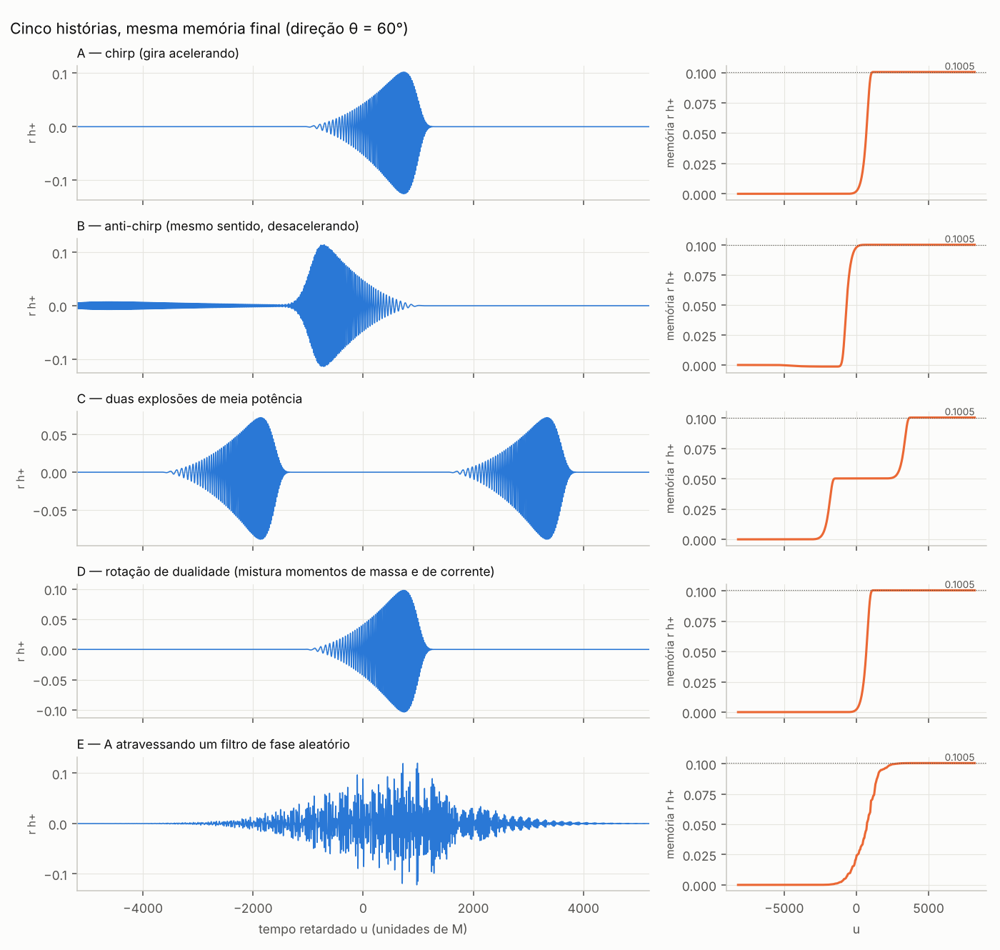
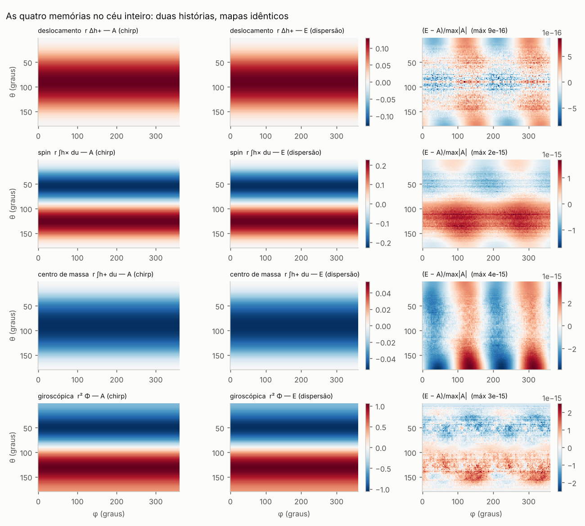
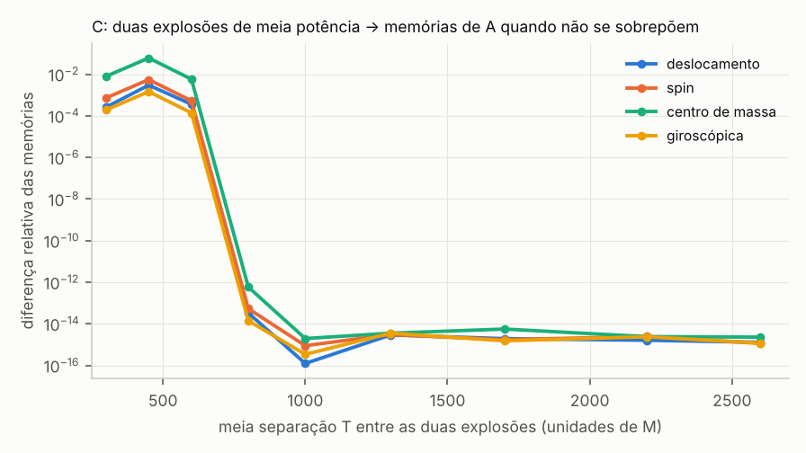

# Etapa 3 — Histórias diferentes com as mesmas quatro memórias

**Pergunta.** Existem duas fontes físicas com histórias diferentes que produzam ao mesmo
tempo a mesma memória de deslocamento, de spin, de centro de massa (CM) e giroscópica?
Se sim, as formas de onda completas também coincidem?

**Resposta curta.** Sim, e não por acaso: na ordem em que as memórias são calculadas
(lineares nas cargas, quadráticas na radiação) as quatro memórias só "veem" duas matrizes
integradas no tempo. Toda a estrutura temporal fora delas fica invisível. Isso gera uma
família infinita de histórias com memórias idênticas no céu inteiro. As formas de onda
completas dessas histórias são diferentes (sobreposição de 0,22 a 0,71 nos exemplos).
Só um caso exige mais que a forma de onda numa direção: a rotação de dualidade (fonte D),
que só se separa pela polarização da memória em relação à oscilação.

Rótulos usados: **[E]** estabelecido na literatura, **[D]** derivado ou verificado aqui
(elementar, mas não encontrei enunciado equivalente; ver `02_caminhos.md` §9),
**[H]** hipótese, **[S]** especulação.

---

## 1. Definições e convenções

- $G=c=1$; $h(u,\Omega)=r\,(h_+-i h_\times)=\sum_{j}h_j(u)\,{}_{-2}Y_j(\Omega)$, com $j=(\ell,m)$.
- Operadores $\eth,\bar\eth$, $D^2$ e $\mathfrak D=\tfrac18D^2(D^2+2)$ como em Mitman et al. 2020 **[E]**.
- As quatro memórias (partes nulas, isto é, as que vêm do fluxo de radiação) seguem das leis de
  balanço BMS, que li no LaTeX original de cada artigo:
  - deslocamento [Mitman2020, eq. ememoryfinal]: $\Delta J^{E}=\tfrac12\bar\eth^2\mathfrak D^{-1}\big[\Delta m+\tfrac14\!\int|\dot h|^2du\big]$;
  - spin e CM: partes imaginária e real da mesma expressão (rotacional e divergência do balanço do
    momento angular, [Mitman2020, eqs. bondiangmomevo_null e radiatedangmom]; para o CM, o
    observável $\Delta\mathcal K$ de [Nichols2018, eq. DeltaCalK]):
    $$\mathfrak D D^2\!\int\!\Psi\,du=\Delta\,\mathrm{Im}[\eth\bar q^A\hat N_A]+\tfrac18\,\mathrm{Im}\,\eth\!\int\!W du,\qquad
      \mathfrak D D^2\,\Delta\mathcal K=\Delta\,\mathrm{Re}[\eth\bar q^A\hat N_A]+\tfrac18\,\mathrm{Re}\,\eth\!\int\!W du,$$
    com $W=3\dot h\,\bar\eth\bar h-3h\,\bar\eth\dot{\bar h}-\dot{\bar h}\,\bar\eth h+\bar h\,\bar\eth\dot h$;
  - giroscópica [SO2022, eqs. t12 e s15]: $r^2\Phi=\int du\,[\tfrac14D_aD_b\tilde C^{ab}-\tfrac18N_{ab}\tilde C^{ab}]$,
    que em termos de $h$ fica $r^2\Phi=-\mathfrak D\!\int\!\Psi du+\tfrac14\!\int\!\mathrm{Im}(\bar h\dot h)\,du$ (convenção $\epsilon_{\theta\phi}=+\sin\theta$; verificado com tensores explícitos, exp01 T9) **[D]**.
- A derivação da parte de CM (divergência do balanço) é minha; conferi contra as fórmulas de modos
  de [Nichols2018, eq. DeltaK35modes]: os três modos testados (3,3), (3,1) e (5,5) batem com razão
  exatamente 1 (exp01 T8). Deslocamento e spin batem com [Favata2009a] e [Nichols2017] (exp01 T1–T4).

## 2. O teorema

**Teorema 1 (redução de Gram) [D].** Seja $h=\sum_j h_j\,{}_{-2}Y_j$ com $h_j,\dot h_j$ de
quadrado integrável e $h_j\to0$ quando $u\to\pm\infty$ (a parte oscilatória da radiação). Defina

$$B_{jk}=\int\dot h_j\,\overline{\dot h_k}\,du,\qquad A_{jk}=\int h_j\,\overline{\dot h_k}\,du .$$

As partes nulas das quatro memórias, como funções no céu inteiro, são funções **lineares** de
$B$ e de $\Omega=A-A^\dagger$:

$$\int|\dot h|^2du=\sum_{jk}B_{jk}\,Y_j\bar Y_k,\qquad
\int W\,du=\sum_{jk}(A^\dagger-A)_{jk}\big[3\,Y_j\,\overline{\eth Y_k}+\bar Y_k\,\bar\eth Y_j\big],\qquad
\int\mathrm{Im}(\bar h\dot h)\,du=\tfrac1{2i}\sum_{jk}(A^\dagger-A)_{jk}\,Y_j\bar Y_k ,$$

(aqui $Y_j={}_{-2}Y_j$), e as memórias saem dessas três funções pelos operadores lineares da §1.

*Demonstração.* Substituindo a expansão em modos em cada termo dos fluxos, cada termo vira
$\int(\text{modo }j\text{ ou derivada})\cdot\overline{(\text{modo }k\text{ ou derivada})}\,du$ vezes uma
função angular fixa. Juntando os termos de $W$, o coeficiente de $Y_j\overline{\eth Y_k}$ é
$3(\overline{A_{kj}}-A_{jk})=3(A^\dagger-A)_{jk}$ e o de $\bar Y_k\bar\eth Y_j$ é
$(\overline{A_{kj}}-A_{jk})$; o mesmo vale para o termo de helicidade. Não há produtos sem
conjugação ($h\,h$), porque os fluxos têm peso de spin 0 ou ±1 e no máximo um $\eth$. A parte
hermitiana de $A$ é $\tfrac12\Delta(h_jh_k^*)$, um termo de borda que se anula. ∎

**Forma espectral.** Com $\tilde h(\omega)=\int h\,e^{i\omega u}du$,

$$B=\int\omega^2\,\tilde h\,\tilde h^\dagger\,\frac{d\omega}{2\pi},\qquad A=i\int\omega\,\tilde h\,\tilde h^\dagger\,\frac{d\omega}{2\pi}\quad(A^\dagger=-A).$$

Ou seja: **as quatro memórias dependem da história só pelos momentos espectrais de primeira e
segunda ordem da matriz espectral cruzada dos modos.** (Conferido numericamente: exp01 T7, erro 1e-16.)

**Corolário 1 (grupo de invariância) [D].** Para qualquer função real $\varphi(\omega)$, o
filtro comum $\tilde h_j(\omega)\to e^{i\varphi(\omega)}\tilde h_j(\omega)$ (o mesmo para todos os
modos) preserva $B$ e $A$, logo as quatro memórias. O grupo contém:
- translações no tempo ($\varphi=\omega T$) — por isso as memórias não dependem da origem do tempo;
- rotações de dualidade constantes ($\varphi=\alpha$), que misturam momentos de massa e de corrente;
- filtros passa-tudo reais ($\varphi$ ímpar), que agem igualmente em $h_+$ e $h_\times$ e preservam o tipo
  da fonte e as simetrias de reflexão.

**Corolário 2 (estados final e inicial).** Energia, momento linear e momento angular irradiados
também são lineares em $(B,\Omega)$. Com o mesmo estado inicial, as histórias do Corolário 1 terminam
com a mesma massa de Bondi, o mesmo momento e o mesmo momento angular. Para fontes sem recuo, o
estado final é o mesmo, e então as partes *ordinárias* (variações de cargas) também coincidem: as
memórias **totais** coincidem. Com recuo, há uma ressalva: o filtro muda o instante médio da emissão
de momento, e o remanescente termina deslocado de $v_{\rm recuo}\,\Delta t$. Isso entra nas cargas de
super-CM com $\ell\ge2$ só em ordem $M v^3\Delta t$. Não calculei esse termo.

**Teorema 2 (fibras de dimensão infinita) [D].** Para qualquer história com algum modo não nulo, o
conjunto de histórias com as mesmas quatro memórias contém a órbita do grupo do Corolário 1, que tem
dimensão infinita. Dois elementos da órbita dão formas de onda diferentes, salvo se $e^{i\varphi}$ for
constante no suporte espectral do sinal. Logo existem infinitas (não enumeráveis) histórias distintas
indistinguíveis pelas quatro memórias. ∎

**Proposição 3 (divisão em explosões) [D].** Trocar uma explosão por $N$ cópias com pesos $w_i$
($\sum w_i^2=1$) em instantes $T_i$ preserva $B$ e $A$, a menos de termos de correlação cruzada
$\int\dot h(u-T_i)\overline{\dot h(u-T_k)}du$, que vão a zero quando as cópias não se sobrepõem.

## 3. As fontes construídas (exp02)

Todas são corpos girantes hipotéticos em gravidade linearizada. Partem do repouso e voltam a ele, e
não têm recuo (só $m$ par e simetria equatorial). Os modos (2,±2), (3,±2), (4,±4) e (4,±2) têm
razões de amplitude típicas de uma binária de massas desiguais. A dinâmica da fonte é prescrita, como
num corpo girante movido por motores, e não autogravitante. Ver §6 para o caso autogravitante.

| Fonte | História | O que muda |
|---|---|---|
| **A** | gira acelerando (*chirp*), $\Omega$ de 0,03 a 0,15 | — |
| **B** | **anti-chirp**: mesmo sentido de rotação, desacelerando | filtro passa-tudo de fase quadrática |
| **C** | duas explosões de meia potência separadas por 5200 M | Proposição 3 |
| **D** | rotação de dualidade de 60° (mistura massa e corrente) | fase constante |
| **E** | A atravessando uma dispersão aleatória | filtro de fase aleatório e suave |

**Memórias.** Diferença relativa máxima em relação a A, sobre todos os modos até $\ell=9$, no céu inteiro:

| Fonte | deslocamento | spin | CM | giroscópica | $\lvert\delta B\rvert/\lvert B\rvert$ | $\lvert\delta\Omega\rvert/\lvert\Omega\rvert$ |
|---|---|---|---|---|---|---|
| B | 6,5e-16 | 1,6e-15 | 2,4e-15 | 1,0e-15 | 4,3e-16 | 8,1e-16 |
| C | 1,3e-15 | 1,1e-15 | 2,3e-15 | 1,2e-15 | 1,5e-15 | 1,7e-15 |
| D | 3,2e-16 | 1,9e-16 | 2,4e-16 | 1,7e-16 | 2,1e-16 | 1,2e-16 |
| E | 1,4e-16 | 7,6e-16 | 1,6e-15 | 6,8e-16 | 8,6e-16 | 3,5e-16 |

Valores de A, para referência ($M=1$, $h$ = $r\times$ deformação): deslocamento $(2,0)=0{,}343$;
spin $(3,0)=0{,}583\,i$; CM $(2,0)=-0{,}149$; giroscópica $(1,0)=-2{,}62$ e $(3,0)=1{,}03$; energia
irradiada $0{,}170\,M$. As quatro memórias são não nulas, e a de CM também, porque os modos (4,2)
e (3,2) se misturam com o (2,2).

**Formas de onda.** Sobreposição com A, maximizada em deslocamento temporal e fase, com produto
interno de ruído branco nas duas polarizações (1 = idêntica):

| Fonte | θ=30° | θ=60° | θ=90° | θ=120° | sem girar a polarização (θ=90°) |
|---|---|---|---|---|---|
| B anti-chirp | 0,22 | 0,22 | 0,22 | 0,22 | 0,22 |
| C duas explosões | 0,71 | 0,71 | 0,71 | 0,71 | 0,71 |
| D dualidade | 1,00 | 1,00 | 1,00 | 1,00 | **0,50** |
| E dispersão | 0,51 | 0,51 | 0,51 | 0,51 | 0,51 |

**Histórias.** Perfil temporal da potência irradiada, que as memórias não veem: centroide em
$u=+643$ (A), $-736$ (B), $+643$ (C, D, E); largura 252 (A), 638 (B), 2612 (C), 815 (E). A energia é a
mesma em todas (0,170 M).

**Divisão (C).** A diferença das memórias cai de ~1e-3 (cópias sobrepostas, $T\le600$) para ~1e-15
quando as cópias se separam ($T\ge1000$).

## 4. O que impede e o que distingue

Na ordem quadrática, nada impede: as quatro memórias são, por construção, cegas a tudo que não está
em $(B,\Omega)$. Distinguir A de B exige observar uma destas coisas:

1. **A forma de onda completa** (B, C e E se separam numa única direção).
2. **Grandezas com peso em $u$.** A integral bruta $\int h\,du$ (sem a subtração de Nichols) contém
   $\int\Phi_n du$, que é o centroide temporal do fluxo em cada direção. Em Fourier isso é
   $\int\omega^2|\tilde h|^2\,\tau_g(\omega)\,d\omega$, que depende do atraso de grupo
   $\tau_g=d\varphi/d\omega$ e muda com o filtro. A memória de CM de Nichols remove exatamente esse
   termo, e por isso é invariante [Nichols2018]. O primeiro momento elétrico da *news* em
   [SGN2024, eq. 3.12] contém esse termo de centroide.
3. **As memórias superiores** $\int u^n N\,du$ [SGN2024]: são momentos lineares da *news*, não momentos
   espectrais quadráticos, e mudam com $\varphi$.
4. **A polarização relativa entre memória e oscilação.** Na fonte D, a oscilação gira de 30° no
   plano de polarização e a memória (elétrica, presa ao padrão do fluxo) não gira. Numa só direção,
   D é idêntica a A girada em torno da linha de visada (sobreposição 1,00 com fase livre). Só a
   memória serve de referência para separar as duas. Ver `04_brechas.md` §8.

## 5. Além da ordem quadrática (exp03)

Na ordem seguinte a própria memória entra nos fluxos ($h=h_{\rm osc}+h_{\rm mem}+h_{\rm spin}$), e
os termos $h_{\rm mem}\dot h_{\rm osc}$ não são invariantes pelo filtro.

- Efeito da ordem cúbica nas memórias de A: 1–2,5%.
- Quebra da igualdade A × B (anti-chirp) nessa ordem: 1,1e-7 (deslocamento), 3,6e-7 (spin),
  1,1e-4 (CM), 1,4e-7 (giroscópica). Isso é coerente com [DS2005]: a dualidade da gravidade
  linearizada falha na primeira ordem autointeragente da RG.
- **Restauração.** A partir de A, apliquei uma dispersão forte crescente (fator $s$ de 0 a 1) e,
  a cada passo, corrigi só a fase espectral para manter as memórias de ordem cúbica iguais às de A
  (Levenberg–Marquardt com 100 funções de fase; o jacobiano tem posto 58 de 58 componentes). A
  memória quadrática fica exata o tempo todo. O resultado final está em `05_experimentos.md` §3:
  a diferença cúbica cai de ~1e-4 para ~1e-8. A sobreposição com A no fim é 0,60, ou seja, uma
  história bem diferente.
- Limite honesto: não cheguei à precisão de máquina, porque o jacobiano é muito mal condicionado
  ($\sigma_{\min}/\sigma_{\max}\approx10^{-9}$) e a convergência é lenta. O posto completo é o que
  o teorema da função implícita pede para existir solução exata por perto. Mas isso é um **argumento,
  não uma demonstração numérica** **[H forte]**.

## 6. Exemplos exatos em todas as ordens, e o caso autogravitante

- **Birkhoff [E].** Qualquer colapso ou pulsação esfericamente simétrica tem exterior de Schwarzschild:
  forma de onda zero e as quatro memórias zero, para qualquer perfil radial e qualquer instante.
  Histórias distintas, dados em $\mathscr I^+$ idênticos, na RG completa.
- **Núcleo do horizonte [E, ilustrado aqui].** Na teoria de espalhamento ([DRSR2018] para a equação de
  onda em Kerr; [Masaood2022] para gravidade linearizada em Schwarzschild), dado inicial ↔ (dados em
  $\mathscr I^+$, dados no horizonte) é uma bijeção. Existem então dados com radiação zero em
  $\mathscr I^+$ e não zero no horizonte. O exp04 constrói um: uma onda que entra e cai **inteira**
  no buraco (fluxo para fora 2,4e-25, nível de arredondamento), indistinguível em $\mathscr I^+$ de
  "nada aconteceu" (ver `05_experimentos.md` §4).
- **Fontes autogravitantes no vácuo (binárias de buracos negros).** Aqui a história não é livre: é
  fixada por ~15 parâmetros. A órbita do filtro de uma forma de onda de binária *não* é, em geral,
  outra forma de onda de binária. A degenerescência das memórias fica restrita ao espaço de
  parâmetros. Para um observador numa direção, ~4–7 números de memória contra ~15 parâmetros deixam
  famílias degeneradas de dimensão ≥8 (contagem de dimensões, **[D]**). No céu inteiro é **pergunta
  aberta [H]** se as memórias quase determinam os parâmetros intrínsecos (massas e spins).
- **Exemplo conhecido do mesmo tipo [E].** [THA2009] mostram que uma binária e um sistema triplo na
  solução de Lagrange têm formas de onda de quadrupolo indistinguíveis. Fontes diferentes, mesma onda
  (na ordem de quadrupolo).

## 7. Conclusão da etapa

1. Histórias distintas indistinguíveis pelas quatro memórias **existem e são genéricas** (Teoremas 1 e 2;
   exemplos A–E com igualdade de 1e-15 no céu inteiro) **[D]**.
2. A razão é estrutural: na ordem em que as memórias são definidas, elas só leem
   $\int\omega\,\tilde h\tilde h^\dagger$ e $\int\omega^2\,\tilde h\tilde h^\dagger$. A fase espectral
   comum, que carrega quase toda a ordem temporal da história, é invisível.
3. As formas de onda completas distinguem B, C e E numa só direção. D exige a polarização relativa
   entre memória e oscilação.
4. Na ordem cúbica a igualdade quebra (1e-7 a 1e-4) e pode ser restaurada em 1e-8 sem sair da classe
   de mesma memória quadrática. Há indício forte, mas não demonstração completa, de degenerescência
   exata em todas as ordens.
5. Indistinguibilidade **total** (mesmos dados em $\mathscr I^+$) também existe: Birkhoff (exato, RG
   completa) e núcleo do horizonte (teoria linear, rigoroso).
