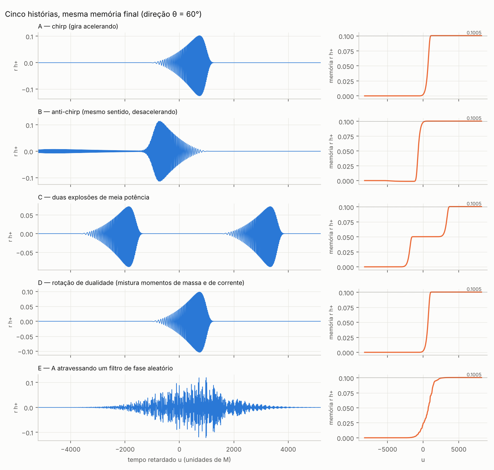
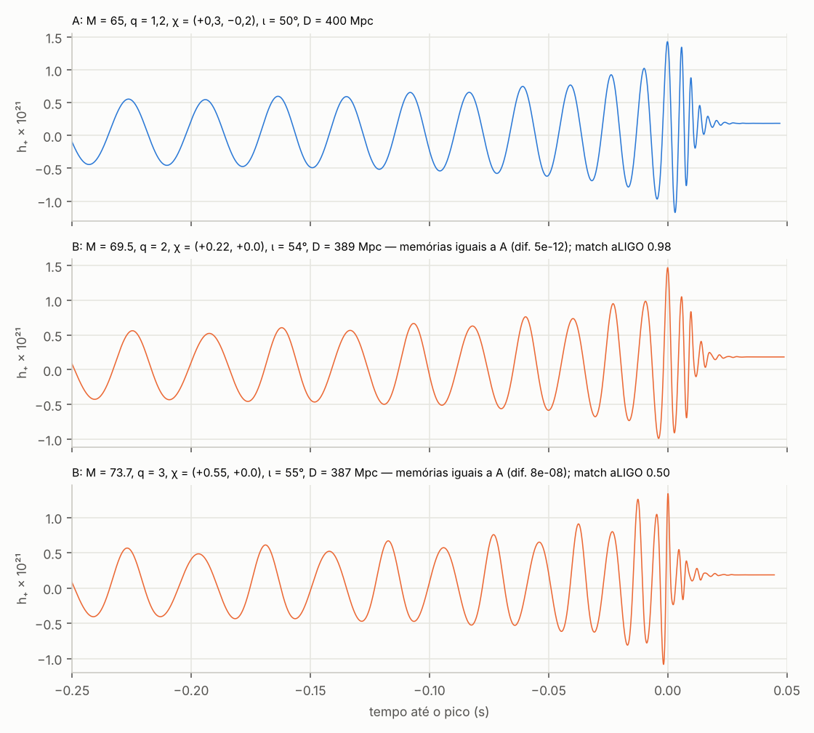

# Reconstrução da história do espaço-tempo por meio da memória gravitacional

Projeto de pesquisa: quanto da história de um sistema físico pode ser reconstruído a partir do
que ele deixa nas ondas gravitacionais, em especial nas memórias gravitacionais (deslocamento,
spin, centro de massa e giroscópica)?

**Estado em 31/10/2026:** etapas 1 a 6 concluídas. As etapas 1–5 tratam fontes gerais (cinco
experimentos). A etapa 6 testa binárias reais de buracos negros com relatividade numérica e modelos EOB
(exp06–exp15). A etapa 7 (identificabilidade e informação) está concluída: revisão adversarial em `08_revisao_e_correcoes.md`, linhas em `09_linhas_de_investigacao.md`, síntese em `10_identificabilidade_e_informacao.md` e relatórios verificados em `linhas/`.

## Resultado principal

**As quatro memórias são medidas de "intensidade", não de "campo".** Na ordem em que são
calculadas, as partes que vêm da radiação dependem da história só por duas matrizes integradas
no tempo: os momentos espectrais de primeira e segunda ordem da matriz espectral cruzada dos
modos, $\int\omega\,\tilde h\tilde h^\dagger$ e $\int\omega^2\,\tilde h\tilde h^\dagger$
(Teorema 1, `03_problema_concreto.md`). Consequências:

- Qualquer filtro de fase comum a todos os modos preserva as quatro memórias no céu inteiro. Daí
  saem infinitas histórias distintas com as mesmas memórias. Exemplos construídos: um corpo que
  gira acelerando × o mesmo desacelerando (anti-*chirp*), uma explosão × duas de meia potência,
  fonte de massa × fonte com mistura de massa e corrente, sinal limpo × disperso. As quatro memórias
  coincidem em 1e-15, e as formas de onda são diferentes (sobreposição de 0,22 a 0,71). A fonte
  de dualidade é a exceção: numa só direção, só se separa pela polarização da memória em relação à oscilação.
- Na ordem cúbica a igualdade quebra pouco (1e-7 a 1e-4) e pode ser restaurada em ~1e-8 ajustando
  só a fase.
- A forma de onda completa separa essas histórias, e a memória é um subproduto dela no vácuo. O
  valor próprio da memória é outro: testa a RG não linear e mede os canais que não são ondas
  gravitacionais (neutrinos, luz, matéria ejetada).

**Etapa 6: binárias reais de buracos negros** (`07_binarias_reais.md`, revista em `08_revisao_e_correcoes.md`):
- A família infinita não contém binárias da RG. Na fase estacionária, os harmônicos $m=2,3,4$ só
  permitem translação no tempo e fase global.
- Num observador, 4 memórias contra ≥ 6 parâmetros deixam famílias contínuas. Há pares exatos para a
  versão idealizada das memórias (multipolos $m=0$, deslocamento total, piso numérico $\sim10^{-6}$).
  Também há pares circular × excêntrica no piso do modelo, com a anomalia $\ell_0$ como dimensão a
  mais. Com o deslocamento de janela e os multipolos $m\neq0$ os pares precisam ser resolvidos de novo
  (etapa 7).
- Um interferômetro não mede as quatro memórias: a giroscópica é inobservável, e o CM se confunde com o
  instante de chegada. A SNR da memória nula de um sistema tipo GW150914 a 400 Mpc é 0,47 (aLIGO), 8,6
  (ET) e 34 (CE).
- A onda completa separa os pares escolhidos a partir de SNR 1–6, mas a família passa pelo próprio
  sistema: o que sobra é a incerteza usual de estimação.
- A memória resolvida no tempo separa os pares com SNR de memória 3–14. Duas janelas deixam uma família
  aproximada.
- No céu inteiro, as memórias quase determinam a binária, exceto por uma direção cega de 2ª ordem em
  massas iguais.

**Etapa 7: identificabilidade e informação** (`10_identificabilidade_e_informacao.md`):
- **As quatro memórias integradas não são observáveis:** a giroscópica não é mensurável e o CM se
  confunde com o instante de chegada. O observável é a forma de onda da memória na banda, e tratar as
  memórias como medidas superestima em 2,5× a informação intrínseca.
- **A memória sozinha determina ~3 combinações** (instante, amplitude $\cos\iota$–$D$, escala de
  massa) e só 1–3 bits intrínsecos, mesmo em CE. Com detector único, 72% de um cubo de razões de massa
  e spins é indistinguível da binária de referência.
- **Teorema de posto** (4 no observador; loci exatos em $\iota=0,\pi/2$). No limite (2,2), spin e
  giroscópica são proporcionais, e o posto intrínseco cai exatamente para 3.
- **Desigualdade memória–energia** $|D\Delta h|\le4E_{\rm rad}$, com constantes ótimas
  $c_2=\sqrt{30}/6$ e $4-c_L\approx8{,}9/L$. A lei da área não é testável pela memória.
- **EDO exata** que recupera o modo dominante a partir dos fluxos, sem ruído. Com ruído, a fase não se
  recupera.
- **Zeros da memória no céu** são eixos ópticos de índice +1/2 e seguem o eixo coprecessante.
- **A memória de CM é um atraso** ($M_f/2$ em $\ell=2$), mas não serve para medir $M_f$.

**Limites rigorosos da reconstrução** (`06_conclusoes_e_limites.md`): nada de dentro de horizontes;
nada do que cai no horizonte (ilustrado numericamente com precisão de 1e-25); nenhuma dinâmica
esférica (Birkhoff); nenhum multipolo estático; reconstrução pela torre de memórias com ruído
amplificado por $\sim e^{a^2/4}$; e nenhum algoritmo, inclusive de IA, extrai mais informação do
que os dados têm.

## Arquivos

| Arquivo | Conteúdo |
|---|---|
| `01_revisao_critica.md` | Etapa 1: a equação central, simplificações perigosas, os nove tópicos anteriores, o que é conhecido e o que é novo |
| `02_caminhos.md` | Etapa 2: abordagens independentes, verificação de originalidade, conexões entre áreas |
| `03_problema_concreto.md` | Etapa 3: Teoremas 1 e 2, fontes degeneradas, comparação de formas de onda, ordem cúbica |
| `04_brechas.md` | Etapa 4: fase, observáveis novos, multimensageiros, informação, simetrias, polarização |
| `05_experimentos.md` | Etapa 5: os cinco experimentos, números e como rodar |
| `06_conclusoes_e_limites.md` | Resposta à pergunta central, limites, previsões verificáveis, problemas em aberto |
| `07_binarias_reais.md` | Etapa 6: binárias reais, pares degenerados, robustez A/B/C, excentricidade, observável de fase, refutações |
| `08_revisao_e_correcoes.md` | Etapa 7, parte 1: revisão adversarial da etapa 6 (25 correções, literatura, o que muda nas conclusões) |
| `09_linhas_de_investigacao.md` | Etapa 7: 19 linhas de investigação com hipótese, fundamentação, teste e prioridade |
| `10_identificabilidade_e_informacao.md` | Etapa 7: síntese verificada (identificabilidade, janelas, informação, fase, precessão, limites, CM como atraso) |
| `linhas/` | Relatório de cada linha da etapa 7 e sua verificação adversarial independente |
| `banco_de_hipoteses.md` | Laboratório permanente de hipóteses, com status (confirmada, refutada, inconclusiva, não testada) |
| `referencias.md` | ~80 referências verificadas online, com correções de atribuição |
| `codigo/` | `harmonicos.py`, `memorias.py` e `fontes.py` com os experimentos `exp01`–`exp05`; `binarias.py`, `deteccao.py` e `pn_excentrico.py` com os experimentos `exp06`–`exp16`; `observaveis.py` (infraestrutura corrigida) com `exp17`–`exp40`; `revisao/` com os scripts da revisão e das verificações |
| `resultados/` | saídas de texto dos experimentos |
| `figuras/` | gráficos gerados pelos experimentos |

## Rótulos usados em todos os textos

- **[E]** estabelecido na literatura (com referência);
- **[D]** derivado ou verificado nesta pesquisa (elementar, mas não encontrado na literatura nessa forma);
- **[H]** hipótese;
- **[S]** especulação.

"Não encontrado na literatura" significa "após busca razoável em 31/10/2026" (`02_caminhos.md` §9),
não "inédito garantido".

## Como reproduzir

```bash
pip install numpy matplotlib mpmath
cd codigo
python3 exp01_verificacao.py          # confere o código contra Favata 2009, Nichols 2017 e 2018
python3 exp02_fontes_degeneradas.py   # etapa 3: cinco histórias, mesmas memórias
python3 exp03_ordem_cubica.py         # etapa 3: o que acontece na ordem cúbica (~10 min)
python3 exp04_horizonte.py            # limite: radiação que só cai no buraco negro
python3 exp05_torre_momentos.py       # limite: reconstruir a onda pela torre de memórias
```

A etapa 6 precisa de `gwsurrogate`, `surfinBH`, `lalsuite`, `teobresums` e `pyseobnr`. A lista de
comandos e a nota sobre a compilação do `pygsl_lite` estão no fim de `07_binarias_reais.md`.




